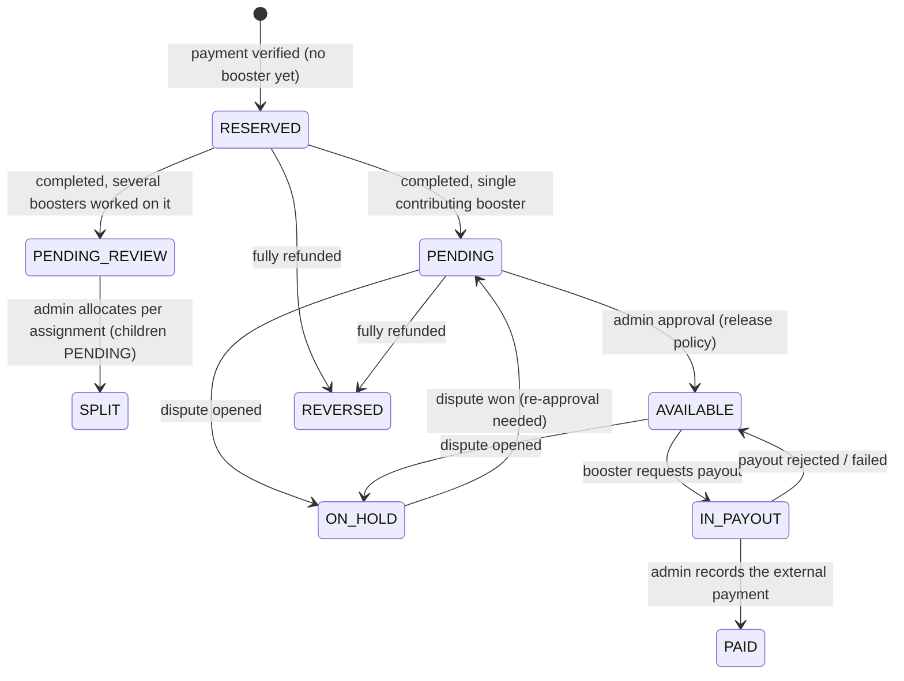

# Financial Ledger Design

**Date:** 2026-11-12
**Business rules implemented:** 45% platform commission / 55% booster share (configurable for future orders, snapshotted per order); manual booster payouts; no Stripe Connect; publication only after verified payment.

---

## 1. Principles

1. **Integer minor units + explicit currency** everywhere. There is no float or Decimal arithmetic for money (`lib/money`). Amounts are bounded (`MAX_AMOUNT = 1e9`), and products that can exceed 2^53 use BigInt.
2. **Snapshot, never recompute.** Each order stores the applied bps and the computed amounts (`OrderPricingSnapshot`). The table is immutable.
3. **Append-only ledger.** `FinancialTransaction` rows are never updated or deleted: a database trigger rejects UPDATE, DELETE and TRUNCATE. Corrections are compensating entries.
4. **Exactly-once postings.** Every entry has a globally unique `idempotencyKey` (for example `payment:<id>:platform_commission`, `refund:<id>:platform`, `payout:<id>:paid:payable`). Retries skip duplicates.
5. **History is never deleted.** Financial relations to orders, users and payments are `onDelete: Restrict`, so deleting an order with financial history fails.
6. **No editable balances.** Every balance is a sum of ledger entries. There is no endpoint to set a wallet amount.
7. **Business-rule decisions not yet made are explicit, safe defaults:** manual earning release, no discounts, no tax, Stripe fees borne by the platform.

## 2. Models

| Model | Role |
|---|---|
| `CommissionPolicy` | Append-only; the policy in force is the newest with `effectiveFrom <= now`. Seeded `4500/5500`. CHECK: the two bps sum to 10000. |
| `ServicePrice` | Versioned admin price list (`docs/ORDER-CREATION-IMPLEMENTATION.md`). |
| `OrderPricingSnapshot` | Immutable per-order price and commission. CHECKs: `base = subtotal − discount`, `total = base + tax`, `platform + booster = base`. |
| `Payment` | One Stripe Checkout attempt. Many per order; `openSlotOrderId` unique (at most one open); `Order.paidPaymentId` unique (at most one paying). |
| `PaymentEvent` | Every verified Stripe event (unique `stripeEventId`), status `RECEIVED/PROCESSED/IGNORED/FAILED`, attempts, safe `lastError`, payload for retry. |
| `FinancialTransaction` | The ledger (`type`, `account`, signed `amount`, `currency`, references, `idempotencyKey`). |
| `BoosterEarning` | Booster share per order / assignment, with status, snapshot bps, `reversedAmount`, approval and release timestamps, payout link. |
| `BoosterPayout` | Manual payout, status machine, method / reference / evidence, actor ids and timestamps. |
| `Refund`, `Dispute` | Stripe refunds (any source) and disputes. |
| `OutboxEvent` | Side effects written with the financial change, dispatched after commit. |
| `FinancialAuditLog` | Append-only audit of admin financial actions (price, commission, earnings, payouts, refunds, event retries). |

## 3. Ledger accounts

| Account | Meaning | Balance |
|---|---|---|
| `CUSTOMER_PAYMENTS` | Money received (+), returned or lost (−) | net customer funds |
| `PLATFORM_REVENUE` | Commission earned (+), reversed (−) | platform commission |
| `BOOSTER_POOL` | Booster share of paid orders not yet attributed (per order) | unallocated booster share |
| `BOOSTER_PAYABLE` | Owed to a booster (per booster; `boosterId` required by CHECK) | outstanding booster liability |
| `BOOSTER_PAYOUTS` | Paid out manually (+) | total payouts |
| `STRIPE_FEES` | Processing fees (+), platform cost | fees |
| `DISPUTE_LOSSES` | Reserved for dispute fees (not yet populated) | — |

Invariant per paid order (tax 0): `CUSTOMER_PAYMENTS = PLATFORM_REVENUE + BOOSTER_POOL + Σ BOOSTER_PAYABLE(order)` until payout. Payouts move `BOOSTER_PAYABLE → BOOSTER_PAYOUTS`.

## 4. Postings per event (example: 100.00 EUR order)

| Event | Entries (minor units) |
|---|---|
| Payment verified | `CUSTOMER_PAYMENT` CUSTOMER_PAYMENTS **+10000** · `PLATFORM_COMMISSION` PLATFORM_REVENUE **+4500** · `BOOSTER_SHARE_RESERVED` BOOSTER_POOL **+5500** |
| Stripe fee known (e.g. 3.20) | `STRIPE_FEE` STRIPE_FEES +320. A platform cost; **never** deducted from boosters. |
| Order completed, single booster B | `BOOSTER_EARNING_ALLOCATED` BOOSTER_POOL −5500 · BOOSTER_PAYABLE(B) +5500 |
| Multi-booster, admin allocates 15.00 / 40.00 | BOOSTER_POOL −1500, BOOSTER_PAYABLE(B1) +1500, BOOSTER_POOL −4000, BOOSTER_PAYABLE(B2) +4000 |
| Partial refund 30.00 | `REFUND` CUSTOMER_PAYMENTS −3000 · `PLATFORM_COMMISSION_REVERSAL` PLATFORM_REVENUE −1350 · `BOOSTER_SHARE_REVERSAL` BOOSTER_POOL or BOOSTER_PAYABLE −1650 |
| Remaining refund 70.00 | CUSTOMER_PAYMENTS −7000 · PLATFORM_REVENUE −3150 · booster −3850. All three accounts net to 0. |
| Dispute lost (100.00) | `DISPUTE_LOSS` CUSTOMER_PAYMENTS −10000 · reversals as for a refund |
| Manual payout 55.00 to B | `BOOSTER_PAYOUT` BOOSTER_PAYABLE(B) −5500 · BOOSTER_PAYOUTS +5500 |
| Unapplied payment (mismatch / duplicate) | CUSTOMER_PAYMENTS +received only; a refund later posts −amount only |

### Refund and dispute split (no drift)

The booster part of each reversal is computed **cumulatively** against the snapshot:

```text
boosterBefore = floor(boosterShare × reversedBefore / base)
boosterAfter  = floor(boosterShare × (reversedBefore + amount) / base)
boosterPart   = boosterAfter − boosterBefore
platformPart  = (base portion of this amount) − boosterPart
```

Any sequence of partial refunds adding up to the total reverses **exactly** the original 45/55. Tested: 99.99 EUR (booster 54.99, platform 45.00) refunded as 3 × 33.33 reverses 5499 / 4500 exactly. The booster part is spread across the order's earnings pro rata to what remains on each (largest remainder, deterministic):

- unallocated earnings: posted against BOOSTER_POOL;
- allocated earnings: posted against BOOSTER_PAYABLE(booster);
- earnings that are already **paid**: the reversal still posts, so the booster balance goes **negative** (a clawback that is recorded, never hidden). Further payout requests are blocked until it is settled.

Earning rows keep `grossAmount` and accumulate `reversedAmount`. Fully reversed, unpaid earnings become `REVERSED`. Original payment, earning and order rows are never deleted.

A full refund of a `PENDING` or `DRAFT` order cancels it (it can never be claimed). A full refund of an `IN_PROGRESS` / `PAUSED` order alerts admins and leaves the work decision to them.

## 5. Booster earnings



- **Contribution rule:** contributors are the assignments of the order with `startedAt` set (claimed and worked), including abandoned or released ones.
  - Exactly one contributor, and it is the completing assignment: the reservation is attributed automatically.
  - Otherwise `PENDING_REVIEW`: nothing is awarded automatically, **never the whole 55% to the final booster**. An admin allocates integer amounts per assignment that must sum exactly to the remaining share, with a mandatory note. Allocation is audited and linked to `assignmentId`.
- **Release policy** (`EARNING_RELEASE_POLICY`): `MANUAL_ADMIN_APPROVAL`; the order must be `COMPLETED`, with no open dispute and no pending refund. No holding period or automatic release exists because none has been decided (limitation F1).
- **No duplicates:** one reservation per order (`reservationKey` unique), one earning per assignment, allocation guarded by status-conditional updates and ledger idempotency keys.

## 6. Manual payouts

`REQUESTED → APPROVED → (PROCESSING) → PAID`, plus `REJECTED` (from REQUESTED or APPROVED) and `FAILED` (from PROCESSING).

- **Request (booster):**
  - takes **all** AVAILABLE earnings of one currency;
  - the amount must be covered by the booster's ledger balance (blocked if a clawback is outstanding);
  - only one open payout per booster and currency (`openKey` unique);
  - earnings move to `IN_PAYOUT` only by a conditional update whose count must match.
- **Paid (admin):**
  - requires **method, external reference and evidence**, plus a payment date not in the future. A database CHECK enforces this too;
  - `(method, externalReference)` is unique, so the same transfer cannot be recorded twice;
  - posts the payout entries once and marks the earnings `PAID`.
- **Reject / fail:** a reason is required; earnings return to `AVAILABLE`.
- Every step is written to `FinancialAuditLog`, and the booster is notified via the outbox.

## 7. Disputes

`charge.dispute.created`:

- creates a `Dispute` (`OPEN`, amount, reason, evidence due date);
- moves the order's `PENDING` / `AVAILABLE` earnings to `ON_HOLD` (approval is blocked while it is open);
- alerts admins.

Evidence is submitted in the Stripe Dashboard. On close:

- `won`: holds released to `PENDING`, so they need re-approval;
- `lost`: the loss is posted once (`lossPostedAt`) with the refund split.

## 8. Discounts, tax and fees

| Item | Status |
|---|---|
| Discounts | **Disabled.** `computeDiscount()` returns 0; `discountAmount` is stored (0). If introduced, the commission base is `subtotal − discount` (already in the snapshot CHECK). Whether the platform or both parties absorb a discount is a pending business decision. |
| Tax | **Disabled.** `computeTax()` returns 0. Tax is stored separately and is **never** part of the commission base. Obligations and jurisdictions need legal input. |
| Stripe fees | Recorded separately (`Payment.stripeFeeAmount`, `STRIPE_FEES`). Platform cost; never deducted from boosters. |

## 9. Reporting (admin finance dashboard)

`lib/finance/queries.ts` derives every figure from the ledger and records:

- customer payments, refunds, net platform commission, Stripe fees, unallocated booster share, outstanding booster liabilities, payouts and dispute losses (per currency);
- earnings by status; payment counts by status; disputes; refunds;
- a work queue: payments needing review, earnings to allocate, earnings to release, payout requests, open disputes, failed webhook events (retry), failed side effects (requeue).

Full transaction history is at `/dashboard/admin/finance/transactions` (filter by order or booster).

## 10. Tests

- `__tests__/payments/finance-flow.test.ts` (23 tests):
  - 45/55 calculation and odd-amount rounding; float and policy rejection; pro-rata and cumulative exactness, including values beyond 2^53;
  - single-booster earning, the approval policy and its audit; no duplicate earnings; multi-booster review and admin allocation (wrong sums and foreign assignments rejected); booster sees only own earnings;
  - payout lifecycle with evidence, duplicate request blocked, duplicate reference blocked, reject releases earnings, admin-only API;
  - partial and full refund exact reversal with auto-cancel; 99.99 split in three exact; refund after payout gives a negative balance; failed Stripe refund posts nothing; pending refund finalised once across `refund.updated` + `charge.refunded`; Dashboard refund reconciled; refund API admin-only with reason and Idempotency-Key replay;
  - dispute hold and lost reversal posted once; won releases the hold;
  - admin summary is admin-only and derived from the ledger.
- `__tests__/payments/migration.test.ts` (11 tests): database-level enforcement of ledger immutability, snapshot sums, policy sums, payout evidence, one paying payment, one open attempt, and restricted deletes.

## 11. Limitations

| ID | Limitation |
|---|---|
| F1 | Earning release is manual only; a holding period, refund window or auto-release needs a business decision. |
| F2 | A negative booster balance (refund after payout) blocks further payouts. Settling it (recovery or write-off) is a manual business process; there is deliberately no balance-editing endpoint. |
| F3 | Dispute fees are not recorded; dispute losses are recorded as the disputed amount. |
| F4 | Multi-currency is supported per record; there is no FX conversion. Payouts are per currency. |
| F5 | Legacy orders (no snapshot) never create earnings; reconcile them manually (`scripts/report-legacy-orders.mjs`). |
