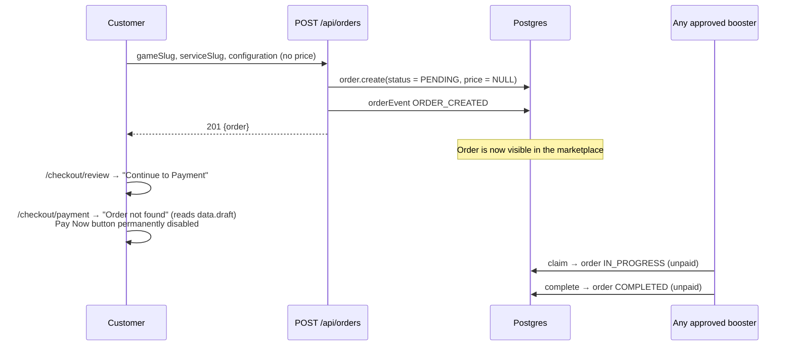
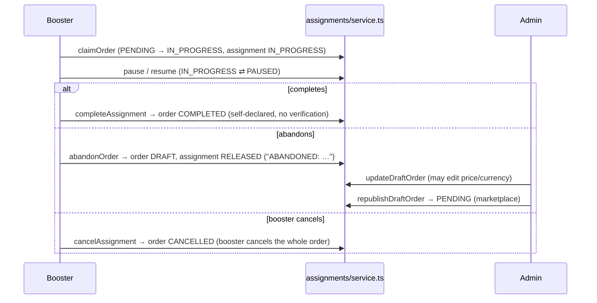
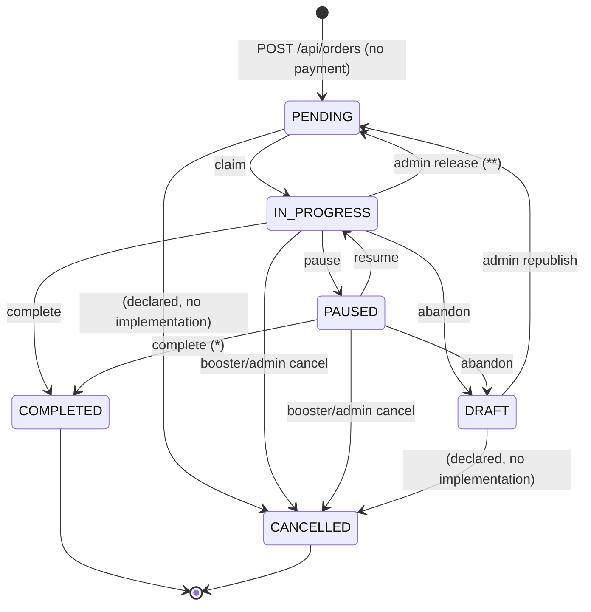
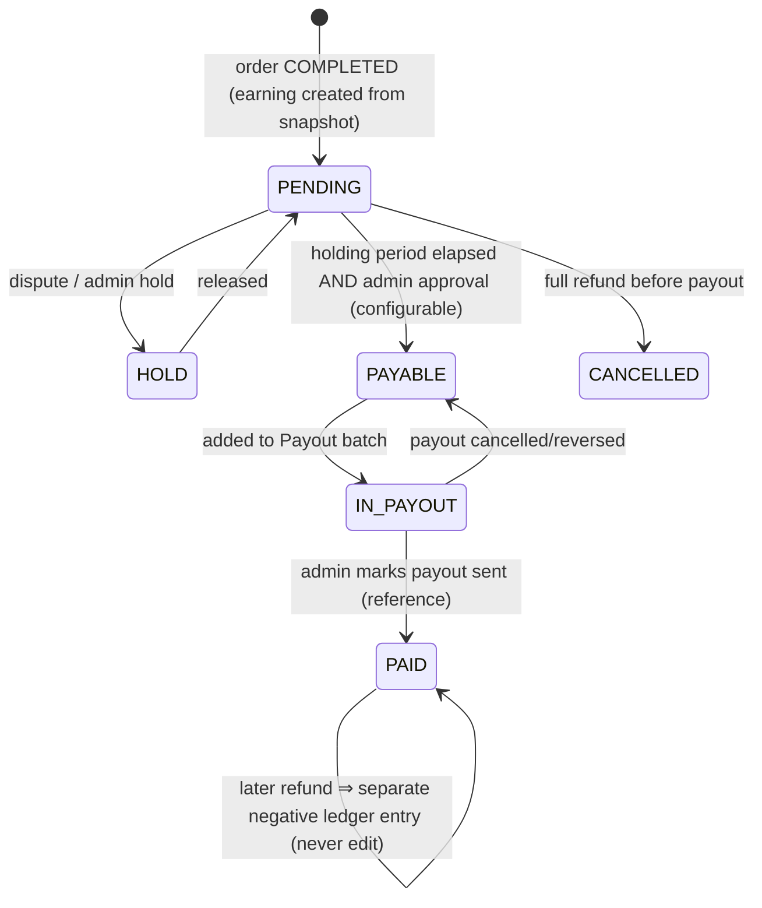
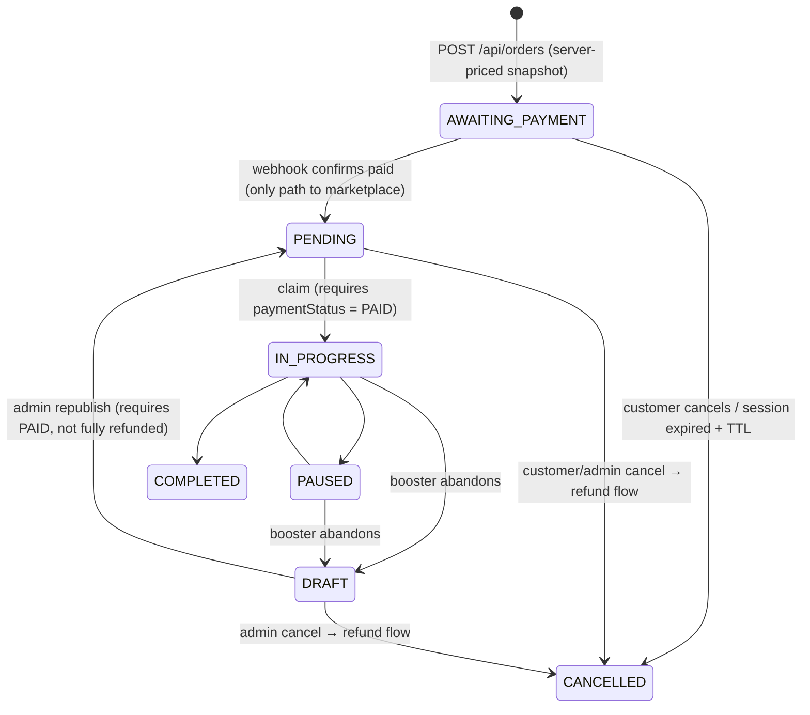

# LegendsBoost — Order, Payment & Financial System Audit

**Date:** 2026-11-12
**Type:** Read-only audit. No application code, Prisma schema, or migration files were changed. No migrations were run, no database was queried, and no Stripe API was called.
**Evidence base:** the working tree at `main` (commit `acef492` plus uncommitted changes), including `prisma/schema.prisma`, all 13 migration folders, every route under `app/api/`, `lib/assignments/*`, `lib/orders/*`, `lib/notifications/*`, `lib/stripe/*`, `components/payment/*`, `components/checkout/*`, `app/checkout/*`, and the existing `docs/PRISMA-MIGRATION-*` reports.

---

## 0. Executive summary

**LegendsBoost has no payment system and no financial system yet.** The repository contains a Stripe *UI shell* (browser SDK, a disabled "Pay Now" button) and a nullable `Order.price` decimal column. There is:

- no server-side Stripe SDK (`stripe` npm package is not installed),
- no Checkout Session, PaymentIntent, webhook endpoint, or signature check,
- no Payment, Refund, Dispute, Commission, Earning, Ledger, Wallet or Payout model,
- no pricing engine (no code calculates a price for any order),
- no customer cancellation and no admin cancellation path.

Most importantly, **`POST /api/orders` creates orders directly in `PENDING`, and `PENDING` is the marketplace state.** Any signed-in user can create an order that boosters can claim and work on immediately, with no payment, no price, and while the catalog marks every service `draft-only` / `allowOrder: false`.

The order/assignment layer (claim, pause, resume, complete, abandon → DRAFT, admin republish) is in reasonable shape. It uses transactions, conditional updates and a unique `activeOrderId` constraint. It is a sound base to add payment on top of, and nothing here needs replacing. The financial layer has to be built from scratch, and some existing data-model choices (cascading deletes, `Decimal` money, nullable currency) must change first.

**Verdict:** *Not ready for implementation until the blockers in §15 are resolved. Not ready to take real money under any circumstances in the current state.*

### Discrepancies from the stated architecture

| Stated | Actual (evidence) | Impact |
|---|---|---|
| Next.js 14 App Router | `next@16.4.3` (`package.json`) | Route handlers use `params: Promise<…>`. A webhook must read the raw body with `await req.text()`. |
| NextAuth/Auth.js | `next-auth@^4.24.15` (v4) with `strategy: "jwt"` (`auth.ts:63`) | `getSessionUser()` re-reads the role from the DB on every call (`lib/auth/guards.ts:15-42`). Good: role revocation takes effect immediately on the API side. |
| Roles CLIENT/BOOSTER/ADMIN | Enum is `CUSTOMER`, `BOOSTER`, `ADMIN` (`schema.prisma:13-17`); `User.role` is **nullable** | "CLIENT" in this report means `CUSTOMER`. |
| Prisma ORM | Prisma 7 with `@prisma/adapter-pg`, explicit `pg.Pool` `max: 2` (`lib/prisma.ts:18-23`) | Interactive transactions hold one of only 2 connections per instance. Long transactions (e.g. calling Stripe inside a tx) would starve the pool. |

---

## 1. Current architecture and flow diagrams

### 1.1 Components

```mermaid
flowchart LR
  subgraph Browser
    CP[CheckoutPanel.tsx] -->|POST /api/orders| API1
    RV[checkout/review] -->|GET /api/orders/:id| API2
    PAY[checkout/payment<br/>PaymentPageClient] -->|GET /api/orders/:id<br/>reads data.draft ✗| API2
    PAY -.->|loadStripe(publishable key)<br/>Elements amount:0| STRIPEJS[(Stripe.js)]
    BM[Booster marketplace] -->|GET /api/booster/orders/available| API3
    BM -->|POST …/claim| API4
    WS[Order Workspace] -->|pause/resume/complete/abandon| API5
    ADM[Admin drafts] -->|PATCH / republish| API6
  end
  subgraph Server["Next.js route handlers"]
    API1[orders/route.ts POST]
    API2[orders/:orderId GET]
    API3[available]
    API4[claim]
    API5[booster/orders/:id/*]
    API6[admin/orders/:id/*]
  end
  API1 & API4 & API5 & API6 --> SVC[lib/assignments/service.ts<br/>lib/orders/draft-admin.service.ts]
  SVC --> DB[(Supabase Postgres<br/>via Prisma 7 + pg)]
  SVC --> NOTIF[lib/notifications/service.ts]
  SVC --> RT[lib/realtime/broadcast.ts<br/>Supabase Realtime]
  NOSTRIPE[[No server Stripe SDK<br/>No webhook route]]:::missing
  classDef missing fill:#fdd,stroke:#c00
```

### 1.2 Current customer flow (as implemented)



### 1.3 Booster lifecycle (as implemented)



---

## 2. Existing models and API endpoints

### 2.1 Models relevant to orders and money

| Model | Money-relevant fields | Notes |
|---|---|---|
| `Order` (`schema.prisma:171-198`) | `price Decimal? @db.Decimal(10,2)`, `currency String?` | Never set at creation. Only an admin editing a DRAFT can set it. No payment status, no paidAt, no snapshot. `user` relation is `onDelete: Cascade`. |
| `OrderEvent` (`:200-211`) | `type String`, `metadata Json?` | The only audit trail. Free-form `type`, no actor column, cascades on order delete. |
| `OrderBoosterAssignment` (`:213-235`) | none | History of who worked on an order. `booster` and `assignedBy` are `onDelete: Cascade`. `@@unique([activeOrderId])` plus DB CHECK `orderBoosterAssignment_active_order_check` (migration `20261102210000`, lines 56-63) guarantee at most one active assignment per order. |
| `Notification` | `dedupeKey` + `@@unique([userId, dedupeKey])` | Already has an idempotency pattern that payments can reuse. |
| `SupportTicket` | `category PAYMENT_ISSUE` | The only payment-related enum value in the schema. |

**Absent:** Payment / PaymentAttempt, StripeEvent (webhook log), Refund, Dispute, CommissionPolicy, OrderFinancialSnapshot, BoosterEarning, LedgerEntry, Payout, PayoutItem, AdminAuditLog, StripeCustomer mapping. `BoosterProfile` has no payout details. That is correct for manual payouts, but there is nowhere to record a payout reference either.

### 2.2 API endpoints touching order state

| Endpoint | Roles | Effect on `Order.status` | File |
|---|---|---|---|
| `POST /api/orders` | any signed-in user (incl. BOOSTER/ADMIN) | creates `PENDING` | `app/api/orders/route.ts:18-76` |
| `GET /api/orders` / `GET /api/orders/:orderId` | owner | read | `app/api/orders/route.ts:78`, `app/api/orders/[orderId]/route.ts` |
| `POST /api/orders/draft` | **unauthenticated** | none (in-memory `Map`, lost on restart) | `app/api/orders/draft/route.ts`, `lib/orders/draft-store.ts` |
| `GET /api/booster/orders/available` | approved BOOSTER | read: all `PENDING` with no active assignment | `app/api/booster/orders/available/route.ts` |
| `POST /api/booster/orders/:id/claim` | BOOSTER | `PENDING → IN_PROGRESS` | `claim/route.ts`, `service.ts:170-305` |
| `POST …/pause` / `…/resume` | BOOSTER (owner) or ADMIN | `IN_PROGRESS ⇄ PAUSED` | `service.ts:307-438` |
| `POST …/complete` | BOOSTER (owner) or ADMIN | `IN_PROGRESS/PAUSED → COMPLETED` | `service.ts:440-557` |
| `POST …/cancel` | BOOSTER (owner) or ADMIN | `IN_PROGRESS/PAUSED → CANCELLED` | `service.ts:559-658` |
| `POST …/release` | BOOSTER → delegates to abandon; ADMIN → `PENDING` | `→ DRAFT` (booster) / `→ PENDING` (admin) | `service.ts:660-747` |
| `POST …/abandon` | BOOSTER (owner) | `IN_PROGRESS/PAUSED → DRAFT` | `service.ts:1075-1164` |
| `POST …/accept` / `…/start` / `…/decline` | BOOSTER | legacy; `start` does an **unconditional** `→ IN_PROGRESS` | `service.ts:751-908` |
| `PATCH /api/admin/orders/:id` | ADMIN | DRAFT only; edits config **and price/currency** | `draft-admin.service.ts:120-176` |
| `POST /api/admin/orders/:id/republish` | ADMIN | `DRAFT → PENDING` | `draft-admin.service.ts:178-243` |
| `GET /api/admin/orders` | ADMIN | lists DRAFT only | `app/api/admin/orders/route.ts` |
| *(no route)* `reassignOrder` | ADMIN | unconditional `→ IN_PROGRESS` | `service.ts:914-1060`. Dead code, no endpoint calls it. |

**Not present:** customer cancel, admin cancel (although `DRAFT → CANCELLED` is declared legal), admin list of all orders, refund, payout, any `/api/stripe/*` or `/api/webhooks/*`.

---

## 3. Order and payment state machines

### 3.1 Declared order state machine (`lib/assignments/types.ts:53-60`)



(\*) `PAUSED → COMPLETED` is **not** in `ORDER_STATUS_TRANSITIONS.PAUSED`, so `canOrderTransition("PAUSED","COMPLETED")` returns false and `completeAssignment` rejects it (`service.ts:464`). The DB update at `service.ts:487` would allow it. The table and the code disagree. Effectively, a paused order must be resumed before completion.
(\*\*) Admin release `IN_PROGRESS/PAUSED → PENDING` (`service.ts:700-703`) is **not** in the declared table and bypasses `validateOrderTransition`.

### 3.2 Every location that changes `Order.status`

| # | Location | Transition | Guarded by |
|---|---|---|---|
| 1 | `app/api/orders/route.ts:48-59` | create → `PENDING` | none (no payment, no capability check) |
| 2 | `lib/assignments/service.ts:211` | `PENDING → IN_PROGRESS` (claim) | conditional `where status: PENDING` + unique `activeOrderId` ✔ |
| 3 | `service.ts:340` | `IN_PROGRESS → PAUSED` | conditional ✔ |
| 4 | `service.ts:400` | `PAUSED → IN_PROGRESS` | conditional ✔ |
| 5 | `service.ts:486` | `IN_PROGRESS/PAUSED → COMPLETED` | conditional ✔ (+ table check) |
| 6 | `service.ts:597` | `IN_PROGRESS/PAUSED → CANCELLED` | conditional ✔, but no financial side effects |
| 7 | `service.ts:700` | `IN_PROGRESS/PAUSED → PENDING` (admin release) | conditional, not in transition table |
| 8 | `service.ts:831` | `PENDING → IN_PROGRESS` (legacy accept) | conditional ✔ |
| 9 | `service.ts:883` | `* → IN_PROGRESS` (legacy start) | **unconditional `where: { id }`** ✗ |
| 10 | `service.ts:971` | `* → IN_PROGRESS` (reassign, unrouted) | **unconditional** ✗ |
| 11 | `service.ts:1113` | `IN_PROGRESS/PAUSED → DRAFT` | conditional ✔ |
| 12 | `lib/orders/draft-admin.service.ts:138` | DRAFT → DRAFT (edit) | conditional ✔ |
| 13 | `draft-admin.service.ts:194` | `DRAFT → PENDING` | conditional ✔ |
| 14 | migration `20261102210000` lines 25-26 | data backfill of legacy statuses | one-off |

No raw SQL writes to `order` exist (`$queryRaw` is used only by the Riot rate limiter).

### 3.3 Assignment state machine (`types.ts:37-46`)

`ASSIGNED → ACCEPTED → IN_PROGRESS ⇄ PAUSED → COMPLETED`, with exits to `DECLINED / CANCELLED / RELEASED`. The current claim flow creates assignments directly in `IN_PROGRESS`. `ASSIGNED`/`ACCEPTED` are reachable only through legacy data. Abandonment is stored as `RELEASED` with `endReason` prefixed `"ABANDONED: "`, so it can't be told apart from an admin release except by string matching.

### 3.4 Payment state machine

**None exists.** There is no payment status field, enum, or model.

---

## 4. Current Stripe integration status

| Item | Status | Evidence |
|---|---|---|
| Browser SDK `@stripe/stripe-js`, `@stripe/react-stripe-js` | installed | `package.json` |
| Server SDK `stripe` | **not installed** | `package.json` |
| `lib/stripe/stripe-client.ts` | browser-only `loadStripe(NEXT_PUBLIC_STRIPE_PUBLISHABLE_KEY)` | treats keys containing `YOUR_KEY` as unconfigured |
| Payment page | non-functional: reads `data.draft` (API returns `data.order`), Elements created with `amount: 0, currency: 'usd'`, "Pay Now" hard-disabled | `PaymentPageClient.tsx:35,86`; `StripePaymentForm.tsx:8` |
| Checkout Session creation | **absent** | no server code |
| PaymentIntent creation | **absent** | no server code |
| Webhook endpoint | **absent** | no route under `app/api` |
| Webhook signature verification | **N/A (absent)** | — |
| Webhook idempotency | **N/A (absent)** | — |
| Stripe env vars in `.env.example` | **none documented** | `.env.example` has DB, auth, Supabase, Riot only |
| Local `.env.local` | contains placeholder Stripe values only (not real keys; not printed here) | git-ignored by `.gitignore:27` |
| Stripe Connect | not used, correctly so, given manual payouts | — |
| Riot integration coupling to payment | none, independent ✔ | `lib/riot/*`, `lib/services/games/*` have no payment references |

**Recommendation:** use **Stripe Checkout Sessions (hosted)** rather than the half-built Payment Element. Checkout handles SCA/3DS, wallets, Stripe Tax and promotion codes, and its `checkout.session.completed` / `checkout.session.async_payment_succeeded` events give one clear confirmation signal. The existing `components/payment/*` can be retired or reduced to a "redirecting to Stripe" page. If the Payment Element is kept, the server must create the PaymentIntent and the UI must use its `client_secret`. The `amount: 0` deferred-intent setup must not reach production.

### 4.1 Webhook requirements (for the implementation phase)

1. `app/api/webhooks/stripe/route.ts`, `export const runtime = "nodejs"`, `dynamic = "force-dynamic"`.
2. Read `await req.text()` **before** any JSON parsing and call `stripe.webhooks.constructEvent(raw, sig, STRIPE_WEBHOOK_SECRET)`. Return 400 on failure. Never trust `event.data` fetched any other way.
3. Insert into a `StripeEvent` table keyed on `event.id` (unique) **inside the same DB transaction** as the state change. Treat a unique violation as "already processed → 200".
4. Never trust amounts from metadata. Compare `amount_total`/`currency` with the server-side snapshot stored on the Payment row and flag mismatches for review.
5. Handle out-of-order delivery. A `charge.refunded` can arrive before the success event has been processed, so use upserts keyed on Stripe object IDs and monotonic state guards.
6. Do no slow work (notifications, broadcasts) inside the transaction. Do it after commit, idempotently (`dedupeKey`).
7. Return 2xx quickly. Stripe retries for up to 3 days, and the handler must stay correct across those retries.
8. Exclude the route from any auth middleware (there is none today; keep it that way) and from the in-memory rate limiter.

---

## 5. Marketplace visibility, eligibility and claim

**Visibility** (`service.ts:74-109`): `status = PENDING` and no active assignment. There is no payment condition, no game/specialization or language matching against `BoosterProfile.specializations`, and no per-booster concurrency limit. The response includes the full `Order` row (`configuration`, `price`, `currency`, `selectedOptions`) and `user { id, name }`.

**Eligibility** (`service.ts:33-58`): `role = BOOSTER` and `verificationStatus = APPROVED`. It is read **outside** the claim transaction. A booster suspended between the check and the insert can still claim (a narrow window, low impact).

**Atomic claim** (`service.ts:170-305`): this is correct for its purpose. The unique index on `activeOrderId` makes concurrent claims fail with `P2002`, and the conditional `order.update({ where: { id, status: "PENDING" } })` throws `P2025` if the order moved. Both errors map to friendly messages. Under PostgreSQL READ COMMITTED, the conditional UPDATE re-checks its predicate after acquiring the row lock, so double-claim is not possible.

**Gaps for payments:**

- A payment gate must be added **inside the same transaction and in the same conditional `where`**, for example `where: { id, status: "PENDING", paymentStatus: "PAID" }`. A pre-check alone is not enough.
- Boosters see the **customer price**, not their payout. Once commission exists, show `boosterGrossAmount` from the snapshot and stop sending `price` to boosters.

---

## 6. Assignment history, abandonment, reassignment, completion

- **History is append-only in practice.** Assignments are ended, never deleted, and `OrderEvent` rows are written in the same transaction. But all of it is deleted by `onDelete: Cascade` if the order, the booster, or the admin who assigned it is deleted (`schema.prisma:183,226-227`). That is unacceptable once earnings depend on it.
- **Abandonment → DRAFT** matches the business rule (`service.ts:1075-1164`) and is tested (`__tests__/orders/lifecycle.test.ts:116-175`). A booster `release` is correctly redirected to abandonment (`service.ts:667-671`).
- **Admin release → PENDING** (`service.ts:673-747`) sends the order straight back to the marketplace. This is admin-initiated, so it doesn't break the rule, but it skips the declared transition table and, in the future, any payment gate.
- **Reassignment** (`service.ts:914-1060`) has no API route. It updates the order unconditionally and creates the new assignment `IN_PROGRESS` with `assignedById = admin`. It is reasonable to keep as an admin tool, but it must get a conditional update and a payment-status check before it is exposed.
- **Completion** is self-declared by the booster. There is no customer confirmation, no admin approval, and no dispute window. That is fine as an operational status, but **completion must not make earnings payable on its own** (see §9). Completion also doesn't record *which* booster(s) earned what when an order passed through several boosters.
- **Multi-booster earnings attribution is undefined.** An order abandoned at 60% progress and finished by a second booster currently has two assignments and no rule for splitting the 55%.

---

## 7. Admin order management and customer cancellation

- The admin UI and API cover **DRAFT orders only** (`listDraftOrders`). There is no admin view of all orders, payments, or financial state.
- `updateDraftOrder` lets an admin **change `price` and `currency` on any DRAFT order** (`draft-admin.service.ts:127-150`). Once orders are prepaid, that mutates the amount the customer already paid. It must be removed or turned into a separate "price adjustment" record that never edits the original snapshot.
- `DRAFT → CANCELLED` is declared but not implemented. An abandoned order an admin wants to stop has no exit today.
- **Customer cancellation does not exist.** There is no route and no UI. The customer dashboard only filters by `CANCELLED`.
- **A booster can cancel the whole order** (`cancelAssignment`, `cancel/route.ts`). The order becomes `CANCELLED` with no refund, no admin review, and only a notification. For a paid order this is an unauthorized financial transition: a booster would effectively decide a refund. With payments, booster "cancel" must be removed or re-routed to abandonment (→ DRAFT).

---

## 8. Notifications and audit log

- **Notifications** (`lib/notifications/service.ts`) are written **after** the business transaction commits, outside it. A crash between commit and notify loses the notification. That is acceptable for UX, but **payment confirmation must not depend on a notification being sent**. `dedupeKey` is used only for `ORDER_COMPLETED`, `BOOSTER_ABANDONED` and `ORDER_REPUBLISHED`. No payment-related `NotificationType` values exist (e.g. `PAYMENT_SUCCEEDED`, `PAYMENT_FAILED`, `REFUND_ISSUED`, `PAYOUT_SENT`).
- **Audit log** = `OrderEvent`. Weaknesses:
  - no `actorId` column; actor is sometimes in `metadata.actorUserId`, often missing (claim, pause, resume, complete, cancel events have no actor),
  - `type` is free text with duplicates (`BOOSTER_ASSIGNED` + `WORK_STARTED` + `ORDER_CLAIMED` for a single claim),
  - deleted with the order (`onDelete: Cascade`),
  - no `previousStatus`/`newStatus` columns, so you can't reconstruct transitions reliably.
- No audit log exists for admin actions outside order events (booster approval, future refunds, payouts, commission changes).

---

## 9. Existing commission, earnings, wallet, refund and payout logic

**None.** The only artefacts are:

- `Order.price Decimal(10,2)` and `Order.currency String?` (nullable, no format check),
- `app/dashboard/booster/cashout/page.tsx`: a "Coming Soon" placeholder with `--` tiles,
- `SupportTicketCategory.PAYMENT_ISSUE`.

There is no 45% / 55% constant anywhere in the codebase.

---

## 10. Can the schema support multiple payment attempts and partial refunds?

**No.** A single nullable `price` on `Order` can't represent multiple Checkout Sessions (abandoned, expired, retried), multiple PaymentIntents, partial refunds, disputes, or adjustments. `Decimal(10,2)` also hard-codes two decimal places, which is wrong for zero-decimal currencies (JPY, KRW) and violates the integer-minor-unit requirement.

---

## 11. Security and authorization findings

| ID | Finding | Evidence | Severity |
|---|---|---|---|
| S1 | Any authenticated user (including BOOSTER and ADMIN accounts) can create live marketplace orders without paying. Catalog `orderCapability: 'draft-only'` / `allowOrder: false` is ignored. | `app/api/orders/route.ts:18-59`; `lib/config/checkout-options.ts:34,59,99,128,155` | **P0** |
| S2 | No price is computed server-side. When payment is added, the amount must come from a server pricing function. The client currently sends no price, which is good, but there is no function to produce one. | `components/checkout/CheckoutPanel.tsx:140`; no pricing module | **P0** |
| S3 | A booster can cancel a customer's order outright. | `service.ts:559-658`, `cancel/route.ts` | **P1** |
| S4 | An admin can rewrite the price of an order that may already be paid. | `draft-admin.service.ts:127-150` | **P1** |
| S5 | Booster can self-complete with no verification. That's harmless today, but becomes a payout trigger if earnings accrue on `COMPLETED`. | `service.ts:440-557` | **P1** (financial) |
| S6 | Raw `error.message` (potentially Prisma internals) is returned in 400 responses from most booster order routes (`{ error: error instanceof Error ? error.message : … }`). | `app/api/booster/orders/[orderId]/*/route.ts` | P2 |
| S7 | `POST /api/orders/draft` is unauthenticated and writes to an unbounded in-memory `Map`, a memory-growth vector. | `app/api/orders/draft/route.ts`, `lib/orders/draft-store.ts` | P2 |
| S8 | The marketplace returns customer `user.id`, full configuration, and the customer price to every approved booster. | `service.ts:90-106` | P2 |
| S9 | `POST /api/orders` has no rate limit and no idempotency key. Double-submit creates duplicate orders, and later duplicate payments. | `app/api/orders/route.ts` | P1 |
| S10 | Legacy `start` and unrouted `reassignOrder` perform unconditional status writes. `start` is reachable by a BOOSTER if any `ACCEPTED` assignment exists. | `service.ts:883-886, 971-974` | P2 |
| S11 | **Supabase exposure unverified.** Prisma migrations enable RLS only on `orderRiotAccount`, `orderMatch`, `riotApiThrottle` and `realtime.messages`. The public anon key is shipped to browsers. If the Supabase Data API exposes `public`, tables such as `user` (has `passwordHash`), `account` (OAuth tokens) and `order` may be readable unless RLS was enabled out-of-band. Any new financial tables **must** be created with RLS enabled and no anon policies. *Not verified against the live project; see Blocker B7.* | migrations grep for `ROW LEVEL SECURITY` | **P0-verify** |
| S12 | `User.role` is nullable and silently defaults to `CUSTOMER` in code. | `schema.prisma:41`, `guards.ts:39` | P3 |

Positive findings: role checks are re-read from the DB per request, the assignment/order ID mismatch check runs **before** mutation (`lib/assignments/route-guard.ts`), and admin draft operations re-assert the admin role inside the service layer.

---

## 12. Race conditions and failure scenarios

### 12.1 Existing (order/assignment)

| Scenario | Current behaviour | Risk |
|---|---|---|
| Two boosters claim simultaneously | One succeeds, the other gets `P2002`/`P2025` → 409 | ✔ safe |
| Complete + abandon at the same time | Both lock the assignment row first; the second one's conditional order update fails → rollback | ✔ safe |
| Two admins republish | Conditional `status: DRAFT` → one wins | ✔ safe |
| Booster suspended mid-claim | Eligibility read outside the tx; the claim may succeed | low |
| `start` on an `ACCEPTED` assignment of a `CANCELLED` order | Unconditional update revives the order to `IN_PROGRESS` | P2 (legacy data only) |
| Process crash after commit, before notification | Notification lost; status correct | acceptable |
| Customer double-clicks "Place order" | Two orders | P1 |

### 12.2 Future payment failure scenarios the design must handle

| # | Scenario | Required control |
|---|---|---|
| F1 | Customer opens two tabs → two Checkout Sessions → pays twice | One *open* session per order (partial unique index on `Payment(orderId) WHERE status IN ('REQUIRES_PAYMENT','PROCESSING')`). Expire the previous session when creating a new one. Webhook: a second success on an already-paid order → auto-refund or flag `DUPLICATE` for admin. |
| F2 | Same webhook delivered twice or concurrently | `StripeEvent.id` unique, inserted in the same tx as the state change. |
| F3 | `payment_intent.succeeded` and `checkout.session.completed` both arrive | Pick one canonical "paid" signal (`checkout.session.completed` with `payment_status = paid`, plus `async_payment_succeeded`). Make transitions idempotent (`where paymentStatus != PAID`). |
| F4 | Webhook arrives before the redirect / success page | The success page must **read** state, never set it. |
| F5 | Redirect arrives but the webhook never does (misconfigured endpoint) | Reconciliation job: list sessions older than N minutes and still pending, then retrieve them from Stripe. Admin "re-sync" button. |
| F6 | Amount mismatch (catalog price changed between session creation and payment) | Snapshot the amount on the Payment row at session creation. Webhook compares and flags. |
| F7 | Customer cancels while a booster claims | Single conditional updates on `Order` (status-guarded). Cancellation after claim → admin flow, not instant refund. |
| F8 | Refund issued in the Stripe Dashboard (out-of-band) | `charge.refunded` / `refund.created` / `refund.updated` webhooks create `Refund` rows keyed on `re_…` id. |
| F9 | Dispute opened after the booster is already paid | `charge.dispute.created` → hold. `…closed (lost)` → booster clawback ledger entry (negative balance). |
| F10 | Admin marks payout as sent twice | `Payout` with unique `(boosterId, reference)`, and `PayoutItem.earningId` unique. |
| F11 | Commission changed while orders are in flight | Snapshot the bps on the order **at payment confirmation** (or session creation; see B3). Never read the live policy for an existing order. |
| F12 | Order abandoned and finished by a second booster | Earnings created per assignment at completion/approval, under an explicit split rule (B4). |
| F13 | Pool exhaustion (pg `max: 2`) during webhook bursts | No Stripe API calls inside DB transactions. Short transactions. |

---

## 13. Financial accounting risks and target model

### 13.1 Risks in the current model

1. `Decimal(10,2)` money with nullable currency → floating/decimal ambiguity, no currency guarantee, wrong for zero-decimal currencies.
2. Mutable `Order.price` → history can be rewritten (S4).
3. Cascading deletes on `Order`, `User` (booster/customer) → deleting an account would erase financial history (a legal/accounting retention issue).
4. No separation of *gross charge*, *tax*, *discount*, *Stripe fee*, *net*, *commission base*.
5. No ledger → balances can only be derived by re-computing, which breaks as soon as a refund or adjustment happens.

### 13.2 Principles

- All amounts are `Int` (or `BigInt` if > 2^31 minor units is plausible) **minor units** plus a non-null `currency CHAR(3)` uppercase ISO-4217 (lower-cased only when sent to Stripe).
- Commission is stored as **basis points** (`platformFeeBps = 4500`, `boosterShareBps = 5500`), with `CHECK (platformFeeBps + boosterShareBps = 10000)`.
- **Snapshot, never recompute.** Each order stores the bps and calculated amounts when payment is confirmed.
- **Append-only corrections.** Refunds, disputes, reversals and adjustments are new rows with their own amounts. Historical rows are never updated except for status fields with monotonic guards.
- **Rounding rule (deterministic, sums exactly):** `boosterGross = floor(commissionBase × boosterShareBps / 10000)`; `platformFee = commissionBase − boosterGross`. Rounding residue always goes to the platform.

### 13.3 Worked example: service subtotal 100.00 USD

| Line | Minor units | Notes |
|---|---:|---|
| Service subtotal | 10000 | from server pricing engine |
| Discount | 0 | |
| **Commission base** (subtotal − discount) | **10000** | |
| Booster gross (55%) | **5500** | `floor(10000×5500/10000)` |
| Platform commission (45%) | **4500** | `10000 − 5500` |
| Tax (if any) | +T | **excluded** from commission base; platform liability |
| Customer total charged | 10000 + T | |
| Stripe fee (e.g. 2.9% + 30¢, from `balance_transaction`) | e.g. 320 | platform cost by default (B2); recorded, does **not** change booster share |
| Platform net | 4500 − 320 = 4180 | reporting only |

### 13.4 Adjustments without rewriting history

| Event | Records created | Booster effect | Platform effect |
|---|---|---|---|
| **Discount** (coupon 20%) | Snapshot: `discountAmount = 2000`, base = 8000 | 4400 | 3600. Discount is shared pro-rata by default; *alternative*: platform absorbs it (booster gets 5500 on the undiscounted subtotal). **Decision B1.** |
| **Tax** | Snapshot `taxAmount` from Stripe Tax `total_details.amount_tax` | none | liability only |
| **Stripe fee** | `Payment.stripeFeeAmount` from the balance transaction | none (default) | cost |
| **Full refund before payout** | `Refund(amount = total)`, ledger: reverse booster earning (status `CANCELLED`), reverse platform revenue | earning → 0, never payable | −4500, and the Stripe fee is usually **not** returned by Stripe |
| **Partial refund R before payout** | `Refund(amount = R)`; allocate using the cumulative method: `boosterReversalTotal = floor(refundedBaseCumulative × boosterGross / commissionBase)`; this refund's booster reversal = that total − previous reversals | payable reduced | remainder |
| **Refund after payout** | `Refund` + ledger `BOOSTER_CLAWBACK` (negative) → booster balance goes negative, recovered from future payouts or written off by admin (`ADJUSTMENT` entry) | negative balance | — |
| **Dispute opened** | `Dispute(status = OPEN)`; place earning on `HOLD` | not payable while held | Stripe debits amount + dispute fee |
| **Dispute lost** | treat as a refund of the disputed amount + `DISPUTE_FEE` platform cost | clawback as above | −fee |
| **Dispute won** | `Dispute(status = WON)`; release hold | payable again | fee may be returned |
| **Payout reversal** (bank bounced / sent in error) | `PayoutReversal` row; ledger re-credits booster balance; earnings return to `PAYABLE` | balance restored | — |

Tax handling (inclusive vs exclusive, which jurisdictions) and the Stripe Tax decision are **out of scope for engineering** and need accounting/legal input (B5).

### 13.5 Earning lifecycle (manual payouts, separate from completion)



### 13.6 Target order + payment state machine (proposal)



`Order.paymentStatus` (denormalised summary): `UNPAID → PROCESSING → PAID → PARTIALLY_REFUNDED → REFUNDED`, plus `DISPUTED`. It is derived from `Payment`/`Refund` rows inside the webhook transaction. Using a new `AWAITING_PAYMENT` order status keeps today's "`PENDING` = marketplace" meaning intact, so `getAvailableOrders`, the workspace and the dashboards keep working. Because `ORDER_STATUS_CONFIG` is typed `Record<OrderStatus, …>`, the compiler will flag every UI map that needs the new value.

### 13.7 Proposed new models (illustrative, not applied)

| Model | Key fields | Key constraints |
|---|---|---|
| `CommissionPolicy` | `id`, `platformFeeBps`, `boosterShareBps`, `effectiveFrom`, `createdById`, `note` | CHECK sum = 10000; append-only; "current" = latest `effectiveFrom ≤ now()` |
| `Order` additions | `currency CHAR(3) NOT NULL`, `subtotalAmount`, `discountAmount`, `taxAmount`, `totalAmount`, `commissionBaseAmount`, `platformFeeBps`, `boosterShareBps`, `platformFeeAmount`, `boosterGrossAmount`, `commissionPolicyId`, `pricingVersion`, `paymentStatus`, `paidAt` | CHECKs: amounts ≥ 0, `platformFeeAmount + boosterGrossAmount = commissionBaseAmount`. Snapshot columns are write-once (enforce in service code plus a DB trigger if desired). Keep legacy `price` read-only until removed. |
| `Payment` | `orderId`, `provider = STRIPE`, `stripeCheckoutSessionId` (unique), `stripePaymentIntentId` (unique), `stripeChargeId`, `amount`, `currency`, `status`, `stripeFeeAmount`, `netAmount`, `idempotencyKey` (unique), `failureCode`, timestamps | partial unique: one `SUCCEEDED` per order, one open attempt per order; FK `onDelete: Restrict` |
| `StripeEvent` | `id` (= `evt_…`, PK), `type`, `livemode`, `apiVersion`, `receivedAt`, `processedAt`, `payload Json`, `error` | PK guarantees idempotency |
| `Refund` | `paymentId`, `stripeRefundId` (unique), `amount`, `currency`, `reason`, `status`, `initiatedById?`, `boosterReversalAmount`, `platformReversalAmount` | CHECK sum of refunds ≤ payment amount (service-level + periodic reconciliation) |
| `Dispute` | `paymentId`, `stripeDisputeId` (unique), `amount`, `feeAmount`, `status`, `reason`, `evidenceDueBy` | — |
| `BoosterEarning` | `orderId`, `assignmentId` (unique), `boosterId`, `grossAmount`, `currency`, `status`, `payableAt`, `heldReason` | `onDelete: Restrict` |
| `LedgerEntry` | `id`, `account` (`BOOSTER_PAYABLE:<id>`, `PLATFORM_REVENUE`, `STRIPE_FEES`, `CUSTOMER_REFUNDS`…), `amount` (signed), `currency`, `orderId?`, `paymentId?`, `refundId?`, `earningId?`, `payoutId?`, `type`, `createdById?`, `idempotencyKey` (unique), `createdAt` | append-only; REVOKE UPDATE/DELETE from app role or use a trigger |
| `Payout` | `boosterId`, `currency`, `amount`, `method` (manual, e.g. bank/PayPal), `externalReference`, `status`, `createdById`, `sentAt`, `reversedAt` | unique `(boosterId, externalReference)` |
| `PayoutItem` | `payoutId`, `earningId` (unique), `amount` | one earning in at most one active payout |
| `AdminAuditLog` | `actorId`, `action`, `entityType`, `entityId`, `before Json`, `after Json`, `ip`, `createdAt` | append-only |

All new FKs to `User` and `Order` should be `onDelete: Restrict`. Account deletion should become anonymisation, not row deletion. Every new table needs `ENABLE ROW LEVEL SECURITY` in its migration (no policies, so it is server-only via Prisma).

---

## 14. Prioritized findings

### P0: blocks taking any payment

| ID | Finding | Fix direction |
|---|---|---|
| P0-1 | Orders enter the marketplace (`PENDING`) without payment. | Add `AWAITING_PAYMENT`. Only the verified webhook moves an order to `PENDING`. |
| P0-2 | No server-side pricing; `price` is null on all customer-created orders. | Server pricing module plus snapshot at order creation. |
| P0-3 | No Stripe server integration, no webhook, no signature verification, no idempotency. | §4.1. |
| P0-4 | No Payment/Refund/Event models; money as nullable `Decimal` + nullable currency. | §13.7. |
| P0-5 | The catalog compliance gate (`draft-only`, `allowOrder: false`) is not enforced by `POST /api/orders`. | Enforce server-side before creating any order. |
| P0-6 | Financial history would be destroyed by `onDelete: Cascade` on `Order.user`, `Assignment.booster`, `Assignment.assignedBy`, `OrderEvent.order`. | Change to `Restrict` for financial FKs; anonymise users instead of deleting. |
| P0-7 (verify) | RLS coverage on `public` tables unknown (S11). | Verify in Supabase before adding financial tables. |

### P1: must be fixed in the same release as payments

| ID | Finding |
|---|---|
| P1-1 | Booster can cancel a paid order (S3). Re-route to abandonment/DRAFT. |
| P1-2 | Admin can edit price/currency of a (future) paid order (S4). |
| P1-3 | No customer cancellation or admin cancellation/refund flow (`DRAFT → CANCELLED` declared but unimplemented). |
| P1-4 | Completion is booster-self-declared. Earnings must not become payable on completion alone (holding period / admin approval). |
| P1-5 | No idempotency or rate limit on order creation (duplicate orders → duplicate payments). |
| P1-6 | Claim and republish must check payment status **inside** the conditional update. |
| P1-7 | No attribution rule for multi-booster orders (abandon + reassign). |
| P1-8 | No admin audit log for financial actions. |

### P2: should be fixed during the payment phases

| ID | Finding |
|---|---|
| P2-1 | Marketplace leaks customer price/user ID; show the booster payout instead. |
| P2-2 | Raw error messages returned to clients (S6). |
| P2-3 | Unauthenticated in-memory draft endpoint (S7). |
| P2-4 | Unconditional status writes in legacy `start` and `reassignOrder` (S10). |
| P2-5 | `ORDER_STATUS_TRANSITIONS` disagrees with code (`PAUSED → COMPLETED`, admin release → `PENDING`). |
| P2-6 | `OrderEvent` lacks `actorId` and `from/to` status; free-text types. |
| P2-7 | Abandonment is indistinguishable from release except via `endReason` string prefix; add an `ABANDONED` assignment status or `endKind` enum. |
| P2-8 | Payment page is broken (`data.draft`, `amount: 0`); remove or replace with a Checkout redirect. |
| P2-9 | In-memory rate limiter (`lib/rate-limit.ts`) is per-instance on Vercel. Not sufficient for checkout abuse. |

### P3: hygiene

| ID | Finding |
|---|---|
| P3-1 | `User.role` nullable. |
| P3-2 | `.env.example` documents no Stripe variables. |
| P3-3 | Cashout page placeholder should be replaced by real balances once the ledger exists. |
| P3-4 | Duplicate claim events (`BOOSTER_ASSIGNED` + `WORK_STARTED` + `ORDER_CLAIMED`). |
| P3-5 | Stated stack in planning docs (Next 14, Auth.js) differs from reality (Next 16, next-auth v4). |

---

## 15. Migration and deployment risks

1. **A migration that was already applied has been edited.** `prisma/migrations/20261102210000_simplify_order_statuses/migration.sql` is modified in the working tree (git `M`, ~48 lines changed: rewrites the default handling, adds explicit `BEGIN/COMMIT` groups). `docs/PRISMA-MIGRATION-FINAL-DECISION.md` records that the inspected DB stored checksum `c3fa9987…` for the *previous* content. Expect `prisma migrate dev` to detect the change and offer a **database reset** (destructive) in any environment where it is run. Treat this as a blocker: decide before any new migration is generated whether to keep the edit (fresh/shadow replay) or revert it (checksum parity). Never accept a reset prompt against Supabase.
2. **Enum additions** (`AWAITING_PAYMENT`, `paymentStatus` values) must follow the pattern already documented in `20261112200000`: `ALTER TYPE … ADD VALUE` committed before any statement uses the value. Don't wrap them in `DO $$` blocks.
3. **Backfill of existing `PENDING` orders.** The inspected dev DB had 5 `PENDING` orders (per the migration decision doc), all unpaid and with null price. When the payment gate ships, they must move to `AWAITING_PAYMENT` or `DRAFT` **in the same deploy**, or they stay claimable as unpaid. Business decision B6.
4. **`IN_PROGRESS`/`COMPLETED` legacy orders** have no payment. They need a `paymentStatus = LEGACY_UNPAID` (or `WAIVED`) marker so earnings/reporting exclude or explicitly include them.
5. **`Decimal price` → integer minor units.** Add new columns. Don't convert in place. Keep `price` read-only for one release, then drop.
6. **Changing `onDelete: Cascade` → `Restrict`** is a constraint drop+add. It's quick on small tables, but it changes behaviour of any user-deletion code. No such code was found, but confirm.
7. **Deploy order:** (a) migrate schema additively, (b) deploy webhook handler in log-only mode and register the endpoint in Stripe **test mode**, (c) deploy checkout plus payment gate behind a feature flag, (d) backfill, (e) enable. The webhook must be live before the first Checkout Session is created.
8. **Vercel + pg pool `max: 2`**: webhook bursts plus normal traffic can exhaust connections. Keep webhook transactions short and consider raising `max` or using the Supabase transaction pooler for `DATABASE_URL` (check prepared-statement compatibility with `adapter-pg`).
9. **Secrets:** `STRIPE_SECRET_KEY` and `STRIPE_WEBHOOK_SECRET` server-only, per environment. Use separate test/live webhook secrets. Never prefix them `NEXT_PUBLIC_`.
10. **Staging/production DB state was never inspected** (per the existing migration docs). Every migration plan needs a per-environment schema check first.

---

## 16. Recommended phased implementation plan

Each phase is independently deployable and reversible. Files marked *(new)* do not exist yet.

### Phase 0: Decisions and environment verification (no code)
- Resolve blockers B1–B8 (§17).
- Verify Supabase RLS / Data API exposure; resolve the edited-migration checksum issue.
- Create Stripe test-mode account settings: webhook endpoint, events subscribed, Checkout branding, Tax decision.

### Phase 1: Containment (no Stripe yet)
Goal: stop unpaid orders from reaching boosters, and remove unauthorized financial transitions.
- `app/api/orders/route.ts`: enforce catalog `orderCapability` / `allowOrder`; restrict to `CUSTOMER`; idempotency key header; rate limit.
- `lib/config/checkout-options.ts`, `lib/catalog/game-services.ts`: single server-side "is orderable" helper.
- `lib/assignments/service.ts`: remove/redirect booster `cancelAssignment` to abandonment; make `startAssignment` and `reassignOrder` conditional; align `releaseAssignment` with the transition table.
- `lib/assignments/types.ts`: reconcile `ORDER_STATUS_TRANSITIONS` with code.
- `app/api/booster/orders/[orderId]/cancel/route.ts`: admin-only or removed.
- `app/api/booster/orders/[orderId]/*/route.ts`: stop returning raw `error.message`.
- `app/api/orders/draft/route.ts`, `lib/orders/draft-store.ts`: require auth or remove.
- `lib/orders/draft-admin.service.ts`, `app/api/admin/orders/[orderId]/route.ts`, `app/dashboard/admin/orders/[orderId]/DraftEditor.tsx`: remove price/currency editing.
- Tests: `__tests__/orders/lifecycle.test.ts`, `__tests__/assignments.service.test.ts`, `__tests__/orders/draft-admin.test.ts`.

### Phase 2: Schema foundation (additive migration)
- `prisma/schema.prisma`: `AWAITING_PAYMENT`, `PaymentStatus` enum, Order snapshot columns, `CommissionPolicy`, `Payment`, `StripeEvent`, `Refund`, `Dispute`, `AdminAuditLog`; `onDelete: Restrict` on financial FKs; `OrderEvent.actorId`.
- `prisma/migrations/<new>_payments_foundation/migration.sql` *(new)*: enum ADD VALUE first (outside tx), tables, CHECK constraints, partial unique indexes, `ENABLE ROW LEVEL SECURITY` on each new table, seed `CommissionPolicy(4500/5500)`.
- `prisma/migrations/<new>_backfill_legacy_orders/migration.sql` *(new)*: per decision B6.
- `lib/orders/statuses.ts`, `lib/orders/status-display.ts`, `components/dashboard/customer/CustomerOrderCard.tsx`, `app/dashboard/customer/page.tsx`, `lib/orders/workspace-access.ts`, `lib/orders/workspace-data.ts`: handle `AWAITING_PAYMENT`.

### Phase 3: Pricing and money utilities
- `lib/money/index.ts` *(new)*: minor-unit helpers, currency exponent table, formatting.
- `lib/pricing/engine.ts` *(new)*: deterministic server price from `gameSlug/serviceSlug/configuration/options/mode` with `pricingVersion`.
- `lib/finance/commission.ts` *(new)*: `getActivePolicy()`, `splitCommission(base, policy)` with the floor rule.
- `lib/catalog/game-services.ts`, `lib/config/checkout-options.ts`: price tables (or a DB-backed price list, decision B8).
- `components/checkout/CheckoutPanel.tsx`, `app/checkout/review/review-client.tsx`: display the server quote.
- Tests: `__tests__/finance/commission.test.ts` *(new)* (100 → 45/55, rounding, odd amounts, zero-decimal currencies), `__tests__/pricing/engine.test.ts` *(new)*.

### Phase 4: Stripe Checkout and webhook
- `package.json`: add `stripe` (server SDK, pinned version and API version).
- `lib/stripe/server.ts` *(new)*: singleton Stripe client, `server-only` import.
- `lib/stripe/stripe-client.ts`: keep for browser or remove if hosted Checkout is used.
- `app/api/orders/[orderId]/checkout/route.ts` *(new)*: owner-only; order must be `AWAITING_PAYMENT`; expire the previous open session; create `Payment` row then Checkout Session with `idempotencyKey`, `client_reference_id = orderId`, `metadata.orderId/paymentId`, amounts from the snapshot.
- `app/api/webhooks/stripe/route.ts` *(new)*: §4.1. Handles `checkout.session.completed`, `checkout.session.async_payment_succeeded/failed`, `checkout.session.expired`, `payment_intent.payment_failed`, `charge.refunded`, `refund.updated`, `charge.dispute.*`.
- `lib/payments/service.ts` *(new)*: `markPaymentSucceeded` (tx: insert `StripeEvent` → update `Payment` → update `Order` `AWAITING_PAYMENT → PENDING` conditional → `OrderEvent`), `recordRefund`, `recordDispute`.
- `lib/payments/reconcile.ts` *(new)* plus an admin-triggered route or Vercel Cron: resync stale sessions.
- `lib/assignments/service.ts` (`claimOrder`, `getAvailableOrders`), `lib/orders/draft-admin.service.ts` (`republishDraftOrder`): add `paymentStatus: "PAID"` to the conditional `where`.
- `app/checkout/payment/page.tsx`, `components/payment/*`: replace with redirect to Checkout plus success/cancel pages that **read** state.
- `lib/notifications/types.ts`, `lib/notifications/service.ts`, `prisma/schema.prisma` (`NotificationType`): `PAYMENT_SUCCEEDED`, `PAYMENT_FAILED`, `REFUND_ISSUED`.
- `.env.example`: `STRIPE_SECRET_KEY`, `STRIPE_WEBHOOK_SECRET`, `NEXT_PUBLIC_STRIPE_PUBLISHABLE_KEY` (placeholders only).
- Tests: `__tests__/payments/webhook.test.ts` *(new)* (bad signature, duplicate event, out-of-order, amount mismatch, double payment), `__tests__/payments/checkout.test.ts` *(new)*, a claim-requires-paid test in `__tests__/orders/lifecycle.test.ts`.

### Phase 5: Cancellation and refunds
- `app/api/orders/[orderId]/cancel/route.ts` *(new)*: customer request. Allowed instantly while `AWAITING_PAYMENT` or `PENDING` (unclaimed); after claim → creates a request for admin.
- `app/api/admin/orders/[orderId]/cancel/route.ts` *(new)*, `app/api/admin/orders/[orderId]/refunds/route.ts` *(new)*: full/partial refund via Stripe Refunds API with idempotency key; `Refund` row created as `PENDING`, finalised by webhook.
- `lib/payments/refunds.ts` *(new)*: cumulative allocation rule.
- `lib/orders/draft-admin.service.ts`: implement `DRAFT → CANCELLED`.
- `app/dashboard/admin/orders/page.tsx`, `app/dashboard/admin/orders/[orderId]/page.tsx`: all-orders view with payment/refund panel.
- `components/orders/*` (workspace): customer cancel button and payment status.

### Phase 6: Earnings, ledger, manual payouts
- `prisma/schema.prisma` + new migration: `BoosterEarning`, `LedgerEntry`, `Payout`, `PayoutItem`.
- `lib/finance/earnings.ts` *(new)*: create earning(s) on completion per split rule (B4), holding period, hold on dispute.
- `lib/finance/ledger.ts` *(new)*: append-only writer with idempotency keys; balance queries.
- `lib/finance/payouts.ts` *(new)*: batch PAYABLE earnings → Payout; mark sent with reference; reversal.
- `lib/assignments/service.ts` (`completeAssignment`): call earnings creation inside the completion tx (or via outbox).
- `app/api/admin/payouts/*` *(new)*, `app/dashboard/admin/payouts/*` *(new)*.
- `app/api/booster/earnings/route.ts` *(new)*, `app/dashboard/booster/cashout/page.tsx`: real balances (pending / payable / paid / negative).
- `app/dashboard/booster/available-orders/AvailableOrdersClient.tsx`, `lib/assignments/service.ts` (`getAvailableOrders` select): show booster payout, hide customer price.
- Tests: `__tests__/finance/earnings.test.ts`, `ledger.test.ts`, `payouts.test.ts`, `refund-after-payout.test.ts` *(new)*.

### Phase 7: Commission configuration and audit
- `app/api/admin/commission/route.ts` *(new)*, `app/dashboard/admin/settings/commission/*` *(new)*: create new `CommissionPolicy` version (effective from now or a future date). Never edit old ones.
- `lib/audit/index.ts` *(new)*: `AdminAuditLog` writer used by refunds, payouts, commission, booster approval (`app/api/admin/boosters/[userId]/approve|reject/route.ts`), draft edits.
- Reporting: per-period revenue, commission, fees, refunds, payouts; reconciliation against Stripe balance transactions.

---

## 17. Verdict and blockers

**Verdict:** The order and assignment core is sound and should be **kept and extended, not replaced**. The payment and financial system **does not exist**: it is a greenfield build on top of that core. The current code must not be used to take money. Phase 1 containment should ship first even if Stripe work slips, because unpaid orders reach the marketplace today.

**Blockers to resolve before implementation starts:**

| # | Blocker | Owner |
|---|---|---|
| B1 | **Discount allocation:** shared pro-rata (booster 55% of discounted base) or platform-absorbed (booster 55% of undiscounted subtotal)? | Business |
| B2 | **Stripe fee bearer:** platform only (recommended) or deducted before the commission split? | Business / finance |
| B3 | **Snapshot moment:** commission bps frozen at order creation (price quote) or at payment confirmation? Recommendation: at quote/creation, re-validated at payment. | Business |
| B4 | **Multi-booster split:** when an order is abandoned and finished by another booster, who earns what (100% to finisher, admin-decided split, progress-based)? | Business / ops |
| B5 | **Tax:** is LegendsBoost required to collect sales tax/VAT; use Stripe Tax; prices tax-inclusive or exclusive; which currencies are supported? | Legal / accounting |
| B6 | **Legacy orders:** what happens to existing unpaid `PENDING`, `IN_PROGRESS` and `COMPLETED` orders at cut-over? | Business / ops |
| B7 | **Supabase exposure:** confirm whether RLS is enabled on all `public` tables and whether the Data API exposes `public` (S11). | Engineering (read-only check) |
| B8 | **Edited migration** `20261102210000_simplify_order_statuses`: keep or revert, and how to reconcile `_prisma_migrations` checksums per environment before generating any new migration. | Engineering / DBA |
| B9 | **Price source of truth:** static catalog in code vs DB-backed price list editable by admins (affects `pricingVersion` and audit). | Business / engineering |
| B10 | **Earning release policy:** holding period length, whether admin approval is needed per earning, refund window after completion, and booster negative-balance policy. | Business / finance |
| B11 | **Compliance status:** every catalog service is `draft-only` / `pending-review`. Confirm which services may actually be sold before enabling checkout. | Business / legal |
