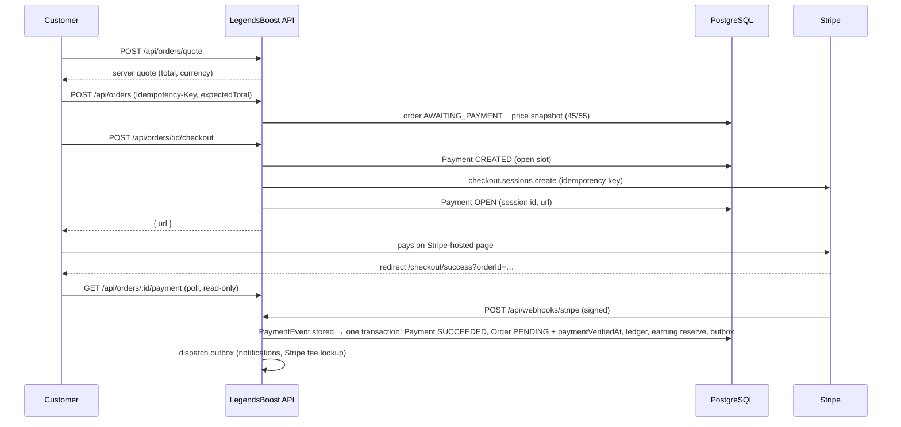
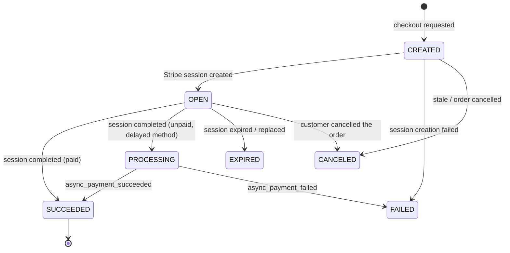
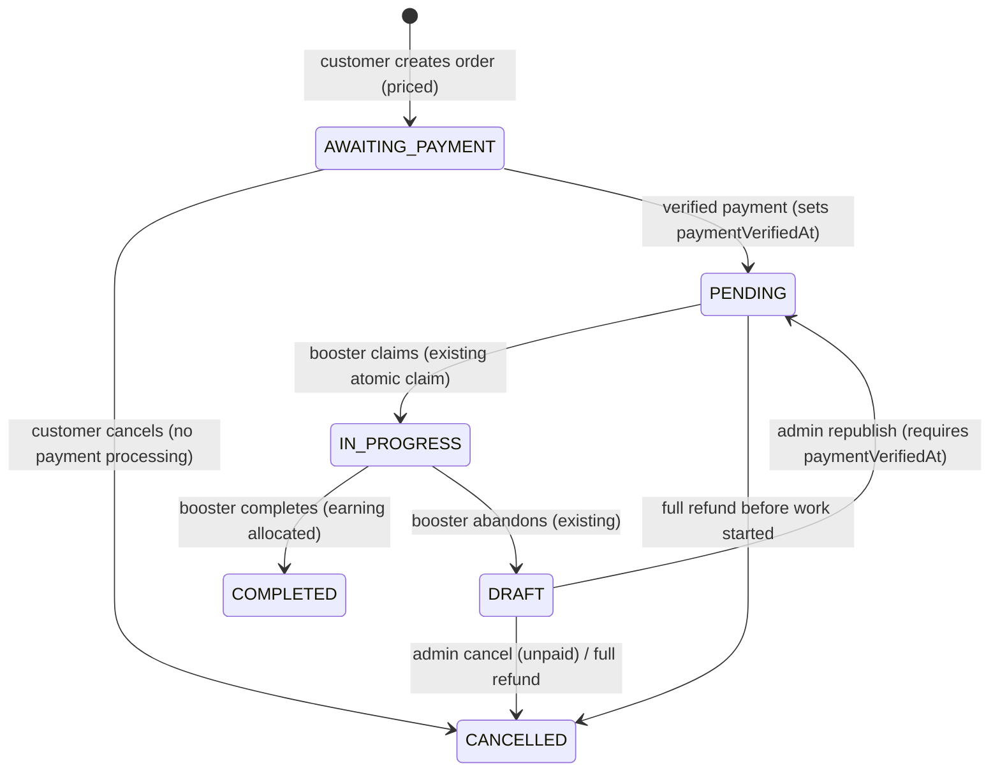

# Stripe Payment Implementation

**Date:** 2026-11-12
**Status:** Implemented and tested locally against an in-memory PostgreSQL and a fake Stripe API client (real Stripe signature verification). **No call to the real Stripe API has been made.** Live payments are not claimed to work until the staging plan in `docs/STRIPE-STAGING-TEST-PLAN.md` passes with Stripe **test mode**.

Related: `docs/ORDER-CREATION-IMPLEMENTATION.md` · `docs/FINANCIAL-LEDGER-DESIGN.md` · `docs/STRIPE-STAGING-TEST-PLAN.md`

---

## 1. Summary

| Item | Choice |
|---|---|
| SDK | `stripe@23.0.1` (server, exact pin). The Stripe API version is the SDK default, **`2026-09-30.endive`**. `@stripe/stripe-js` stays installed but is unused by the payment flow. |
| Integration | **Stripe-hosted Checkout Sessions** (`mode: "payment"`), one session per payment attempt. No Payment Element, no Stripe Connect. |
| Amount source | The order's immutable `OrderPricingSnapshot` only. The browser never sends an amount to the checkout endpoint. |
| Confirmation | Only a **signature-verified webhook** marks an order paid (`Order.paymentVerifiedAt`). The success page only reads state. |
| Idempotency | Stripe idempotency key per attempt (`checkout:<orderId>:<attempt>`) and per refund (`refund:<refundId>`); unique `PaymentEvent.stripeEventId`; unique ledger `idempotencyKey`; one open attempt per order; one paying payment per order. |
| Safety switch | Live keys (`sk_live_`, `rk_live_`) and live-mode webhook events are refused unless `STRIPE_LIVE_MODE_ENABLED="true"`. |

## 2. Flow

## 3. Checkout creation: `POST /api/orders/[orderId]/checkout`

`lib/payments/checkout.service.ts`:

1. CUSTOMER role, re-read from the database; must own the order (404 otherwise).
2. Order must be `AWAITING_PAYMENT`, not paid (`paymentVerifiedAt`, `paidPaymentId` null), and have a price snapshot (legacy orders cannot be paid online).
3. Stripe and `APP_URL` must be configured (503 otherwise). Redirect URLs never come from request headers.
4. In one transaction:
   - If an **open** attempt exists and its session is valid for at least 2 more minutes, it is **reused** (same URL, no new Stripe call).
   - A `PROCESSING` attempt blocks a new one (409).
   - A stale `CREATED` attempt (under 2 min old) returns 409 "being prepared".
   - Expired or abandoned attempts are closed, and their session is expired via the outbox.
   - Then a new `Payment` row is created with `openSlotOrderId = orderId`. That column is unique, so two concurrent requests cannot both open an attempt.
5. `stripe.checkout.sessions.create` is called with the idempotency key `checkout:<orderId>:<attemptNumber>`, using:

   | Parameter | Value |
   |---|---|
   | Line item | `price_data` with the snapshot `unit_amount` / `currency` |
   | `metadata` and `payment_intent_data.metadata` | `{ orderId, paymentId, customerId }` |
   | `client_reference_id` | `orderId` |
   | `expires_at` | 31 minutes |
   | Return URLs | `APP_URL/checkout/success?orderId=…&session_id={CHECKOUT_SESSION_ID}` and `/checkout/cancelled?orderId=…` |
6. If Stripe fails, the attempt becomes `FAILED` (`failureCode = checkout_session_create_failed`, safe message) and the slot is released, so a retry creates attempt N+1. If Stripe echoes a different amount or currency, the session is expired and the attempt failed.
7. On success the Payment becomes `OPEN` with session id, URL and expiry, and the response is `{ url }`.

Metadata is only used for cross-checking. A payment is identified by the session id stored on our row; metadata never proves payment.

## 4. Webhook: `POST /api/webhooks/stripe`

`app/api/webhooks/stripe/route.ts` → `lib/payments/webhook.service.ts`. Runtime `nodejs`, `force-dynamic`. No session auth: the Stripe signature is the authentication.

1. The raw body is read with `req.text()` and verified with `Stripe.webhooks.constructEvent(raw, stripe-signature, STRIPE_WEBHOOK_SECRET)`. A missing or invalid signature returns 400 and stores nothing; a missing secret returns 500.
2. The event is stored in `PaymentEvent` (unique `stripeEventId`) before processing. A known `PROCESSED`/`IGNORED` event returns 200 `{ duplicate: true }`.
3. Processing runs in **one transaction** that first claims the row with a conditional `RECEIVED|FAILED → PROCESSED` update. A concurrent delivery of the same event blocks on the row lock, then finds it processed.
4. Any error rolls the whole transaction back, marks the event `FAILED` with a safe `lastError`, and returns 500, so Stripe retries. Admins can also re-process from the stored payload (`POST /api/admin/finance/events/:id/retry`).
5. Network calls are never made inside the transaction. The refund list for `charge.refunded` is fetched before it. Side effects (notifications, Stripe fee lookup, session expiry) are written to the `OutboxEvent` table in the same transaction and dispatched after commit, so a failing notification can never lose or undo a payment.

### Events handled

| Event | Behaviour |
|---|---|
| `checkout.session.completed` | `payment_status = "paid"` → apply success (below). `"unpaid"` (delayed methods) → attempt `PROCESSING`, **not published**. `"no_payment_required"` → flagged for review. |
| `checkout.session.async_payment_succeeded` | Apply success. |
| `checkout.session.async_payment_failed` | Attempt `FAILED`, slot released, `PAYMENT_FAILED` event and customer notification. Order stays `AWAITING_PAYMENT`; retry allowed. |
| `checkout.session.expired` | Attempt `EXPIRED`, slot released. |
| `payment_intent.payment_failed` | Failure code and message recorded on the attempt. The attempt is **not** closed: inside Checkout the customer can retry on the same session; closure comes from `async_payment_failed` / `expired`. |
| `charge.refunded` | Every refund on the charge is reconciled (`refund.list` prefetched); exactly-once posting. |
| `refund.created` / `refund.updated` / `refund.failed` | Refund reconciled by Stripe id or `metadata.refundId`; Dashboard-created refunds are recorded with `source = STRIPE`. |
| `charge.dispute.created` / `.updated` / `.closed` | Dispute recorded and surfaced to admins; earnings put on hold; lost → reversal posted once; won → hold released. |
| anything else | Stored and `IGNORED` (`unhandled_event_type`). |

### Applying a successful payment (inside the event transaction)

1. Find the attempt by `stripeCheckoutSessionId`. A crash between Stripe creation and our update is recovered by `metadata.paymentId`, but only if the attempt has no session yet.
2. Verify `metadata.{orderId,paymentId,customerId}` and `client_reference_id`; the order belongs to the payment's customer; **amount and currency equal both the attempt and the order snapshot**; the order is `AWAITING_PAYMENT` and not already paid.
3. If any check fails, the money is recorded but **never applied**:
   - the Payment becomes `SUCCEEDED` with a `reviewReason` (`METADATA_MISMATCH`, `CUSTOMER_MISMATCH`, `CURRENCY_MISMATCH`, `AMOUNT_MISMATCH`, `DUPLICATE_PAYMENT`, `ORDER_NOT_PAYABLE`, `NO_PRICE_SNAPSHOT`);
   - a `CUSTOMER_PAYMENTS` ledger entry is posted;
   - admins are alerted;
   - the order is not published.

   These payments appear under "Payments needing review" for a refund.
4. Otherwise:
   - Payment `SUCCEEDED` (`amountReceived`, `succeededAt`, slot released).
   - Conditional order update `AWAITING_PAYMENT, paymentVerifiedAt NULL, paidPaymentId NULL → PENDING, paymentVerifiedAt = now, paidPaymentId = payment`. This is the **only** application code that writes `paymentVerifiedAt`, and a static test enforces that.
   - Ledger: `CUSTOMER_PAYMENT +total`, `PLATFORM_COMMISSION +45%`, `BOOSTER_SHARE_RESERVED +55%`.
   - `BoosterEarning` reservation (`RESERVED`, booster not yet known).
   - `PAYMENT_CONFIRMED` order event.
   - Outbox: customer notification and Stripe fee lookup.

The order is now visible in the existing marketplace (`PENDING` with a verified payment). The existing atomic claim is unchanged.

## 5. State machines

### Payment attempt (`PaymentStatus`)

`SUCCEEDED` with `reviewReason` means money was received but not applied (refund it). Refunds and disputes never change the attempt status; they are separate records (`amountRefunded`, `Refund`, `Dispute`).

### Order (payment-related part)

## 6. Security

- `STRIPE_SECRET_KEY` and `STRIPE_WEBHOOK_SECRET` are read only in `lib/stripe/server.ts` (server routes); neither has a `NEXT_PUBLIC_` prefix.
- Errors stored or logged pass through `safeErrorMessage` (type, code and message only). The webhook route never logs payloads or headers.
- All endpoints authorize on the server, with the role re-read from the database:
  - **Customer**: own order, quote, checkout and payment status only.
  - **Booster**: own earnings and payouts only.
  - **Admin**: every finance API (`requireRole("ADMIN")`).
- Rate limits (per instance): quote 60/min, checkout 10/min per customer.
- New tables have RLS enabled with no policies, so the Supabase anon key exposes nothing.
- `PaymentEvent.payload` stores the verified Stripe event, which can contain customer contact details (for example Checkout `customer_details`). It is server-only (RLS); define a retention period (limitation L9).

## 7. Files

**New**
- `lib/stripe/server.ts`
- `lib/payments/checkout.service.ts`
- `lib/payments/webhook.service.ts`
- `lib/payments/outbox.ts`
- `app/api/orders/[orderId]/checkout/route.ts`
- `app/api/orders/[orderId]/payment/route.ts`
- `app/api/webhooks/stripe/route.ts`
- `app/api/admin/finance/events/[eventId]/retry/route.ts`
- `app/api/admin/finance/outbox/route.ts`
- `app/checkout/success/page.tsx`, `app/checkout/cancelled/page.tsx`
- `components/payment/CheckoutReturn.tsx`

**Modified**
- `components/payment/PaymentPageClient.tsx`: hosted Checkout redirect; previously a disabled Payment Element with amount 0.
- `app/checkout/review/review-client.tsx`: server price lines.
- `lib/orders/cancellation.service.ts`: refuses while a payment is `PROCESSING`; closes the open attempt and expires its session.
- `lib/notifications/types.ts`: new notification types.
- `.env.example`, `package.json` / `package-lock.json` (`stripe`, test-only `@electric-sql/pglite*`).

## 8. Tests (`__tests__/payments/payment-flow.test.ts`, 29 tests)

| Area | Cases |
|---|---|
| Checkout | Exact amount and currency; idempotency key; metadata; another customer 404; booster/admin 403; repeated request reuses the session (one Stripe call); Stripe outage → `FAILED` + slot released, retry creates attempt 2; already-paid 409; cancelled order 409; Stripe not configured 503 with nothing created; owner-scoped read-only status endpoint. |
| Webhook basics | Invalid and missing signature 400 (nothing stored); success → `PENDING` + `paymentVerifiedAt` + `paidPaymentId` + 45/55 ledger + reservation + marketplace listing; duplicate event; second event type for the same payment. |
| Delayed methods | Completed+unpaid → `PROCESSING`, not published, customer cannot cancel; async success publishes; async failure → `FAILED`, unpublished, retry allowed; `payment_intent.payment_failed` recorded without closing; expired session. |
| Unapplied money | Amount mismatch; currency mismatch; wrong order metadata; duplicate payment for a paid order; unknown session; live-mode event ignored. |
| Failure handling | Database failure inside processing → rolled back, event `FAILED`, Stripe retry succeeds; notification failure after payment → payment intact, outbox retries; Stripe fee recorded as a platform cost only. |
| Marketplace | Unpaid invisible, paid listed, atomic claim by two boosters → exactly one. |

## 9. Limitations

| ID | Limitation |
|---|---|
| L1 | **Not verified against real Stripe.** Run the staging plan in test mode first. |
| L2 | Nothing is purchasable today: every catalog service is `draft-only` / `pending-review` / `allowOrder: false`, and no prices exist. Enabling a service is a business decision (catalog flags in code, plus an admin price). |
| L3 | Outbox dispatch runs after each webhook or financial action and from the admin dashboard. There is no scheduled job; add a cron if side effects must flow without traffic. |
| L4 | The Stripe processing fee is fetched from the balance transaction after the payment. If it is not available yet, the outbox retries with back-off (6 attempts). |
| L5 | Dispute fees charged by Stripe are not recorded (only the disputed amount on loss). |
| L6 | Unapplied payments (`reviewReason`) are not refunded automatically; an admin refunds them from the finance dashboard. |
| L7 | Rate limits are in-memory per serverless instance. |
| L8 | The webhook endpoint must be created with API version `2026-09-30.endive` (the SDK's version) so payload shapes match. |
| L9 | `PaymentEvent.payload` retention (contains customer contact data) needs a policy. |
